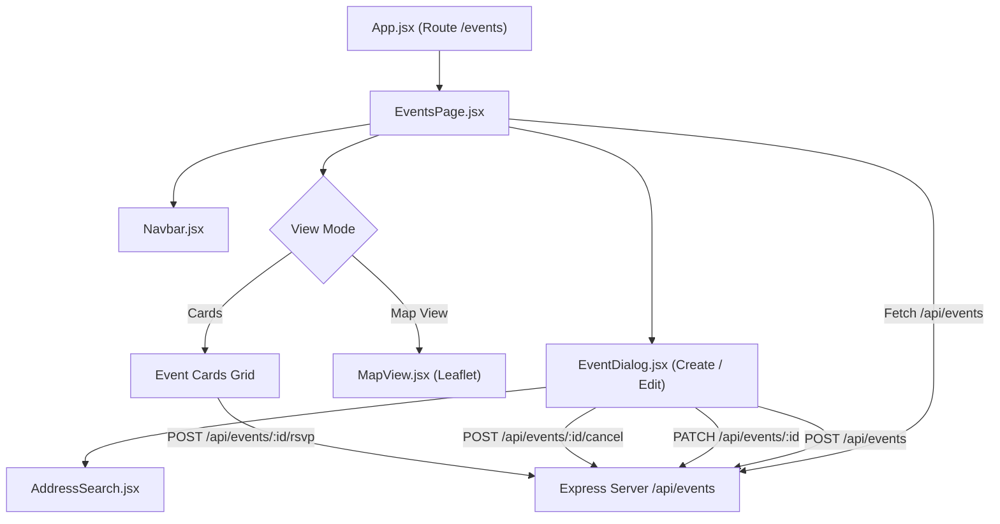

# M4b — Port Events Page, Leaflet Map, and Event Dialog (P3.5)

## 1. Goal & Scope
Port the `/events` page from the legacy Next.js application (`src/app/events/page.jsx`, `src/components/MapView.jsx`, `src/components/CreateEventDialog.jsx`) to the React (Vite) client in `client/`:
- **Event Feed & Cards (`client/src/pages/EventsPage.jsx`)**:
  - Displays list of upcoming and user events with responsive toggle ("Upcoming Meetups" vs "My Events") and view mode toggle ("Cards" grid vs "Map View").
  - Rich event cards with host information (avatar, name linking to `/profile/:id`), "Your Event" badge for events hosted by current user, formatted date/time, location address, distance indicator (`formatDistance`), going count / capacity indicator (`3 / 10 going` or `N Going`), and status badges.
  - Interactive RSVP toggle with loading states, error handling (409 Conflict, 429 Rate Limit), and full state enforcement.
  - P3.5 Host controls: "Edit" and "Cancel" buttons for active hosted events.
  - Pagination support: "Load more" button displayed if `meta.hasNextPage` is true.
  - Empty states, loading skeletons, and error handling.
- **Interactive Leaflet Map (`client/src/components/MapView.jsx`)**:
  - Direct Leaflet integration with OpenStreetMap tile layer and proper attribution.
  - Bundler-safe marker icon asset configuration.
  - Safe popup rendering preventing XSS vulnerabilities (plain text / DOM escaping).
  - Clean lifecycle handling (cleanup via `map.remove()` on unmount, `map.invalidateSize()` on view visibility toggle).
  - Skips marker placement for events missing coordinates.
- **Unified Event Dialog (`client/src/components/EventDialog.jsx`)**:
  - Dual-mode modal supporting event creation and host editing.
  - Form fields: title (1-120), description (1-1000), date/time (`datetime-local`), location (1-200), max attendees limit (1-1000 optional).
  - Address search integration via `client/src/components/AddressSearch.jsx` (fills latitude/longitude and location if empty).
  - Collapsible manual coordinate inputs (`lat`, `lng`).
  - Edit mode prefill and differential patch generation (`PATCH /api/events/:id` sending only changed fields).
  - Host cancellation confirmation sub-dialog (`POST /api/events/:id/cancel`).
- **Pure Event Helpers (`client/src/lib/events.js`)**:
  - Date format round-tripping between local input format (`YYYY-MM-DDTHH:mm`) and ISO UTC string.
  - Differential patch builder (`buildEventPatch`).
  - RSVP eligibility calculation (`canRsvp`).
  - Event status label and badge resolver (`eventStatusLabel`).
- **Dependencies**:
  - Install `leaflet` at `^1.9.4` in `client/package.json` (matching root `package.json`). No other new dependencies.

---

## 2. P3.5 UI States Matrix

| State | Host | Attendee / Visitor | Card Appearance | RSVP Button | Host Actions |
|---|---|---|---|---|---|
| **Active (Normal)** | Viewer is host | Viewer is not going | Normal border, "Your Event" badge | "RSVP Going" (or confirmed if host auto-joined) | "Edit" & "Cancel" visible |
| **Active (Going)** | Viewer is attendee | Viewer is going | Normal border | "RSVP Confirmed" (green, clicking toggles OFF) | None |
| **Active (Full, Not Going)** | Viewer is not host | Viewer is not going | Normal border, "Full" badge (`isFull`) | Disabled: "Event full" | None |
| **Active (Full, Going)** | Viewer is attendee | Viewer is going | Normal border, "Full" badge | "RSVP Confirmed" (enabled, can toggle OFF) | None |
| **Cancelled** | Viewer is host | Viewer is RSVP'd attendee | Greyed-out card (opacity-70), "Cancelled" badge | Hidden / Disabled: "Event cancelled" | None (cannot edit/cancel) |

*Note: Cancelled events are only returned by the server to the host or users who have an RSVP record; client displays whatever cancelled events the API provides.*

---

## 3. Component Architecture & Data Flow

### Component Details
1. **`client/src/lib/events.js`**:
   - `toLocalInputValue(dateOrIso)`: Formats a Date or ISO string to local `YYYY-MM-DDTHH:mm` suitable for `<input type="datetime-local">`.
   - `fromLocalInputValue(localStr)`: Converts `YYYY-MM-DDTHH:mm` string to ISO UTC format (`new Date(localStr).toISOString()`).
   - `buildEventPatch(original, form)`: Compares original event properties with form values and returns an object containing only changed fields (`title`, `description`, `location`, `dateTime`, `lat`, `lng`, `maxAttendees`). Returns `{}` if nothing changed.
   - `canRsvp(event, viewerId)`: Returns `{ canToggle: boolean, reason?: string }`.
     - Cancelled: cannot RSVP (`canToggle: false, reason: 'cancelled'`).
     - Going: can always toggle off (`canToggle: true`).
     - Full and not going: cannot RSVP (`canToggle: false, reason: 'full'`).
     - Otherwise: can RSVP (`canToggle: true`).
   - `eventStatusLabel(event, viewerId)`: Returns status badge details (`{ label, variant, className }`).
2. **`client/src/components/MapView.jsx`**:
   - Accepts `events` array prop.
   - Renders container `div` with ref.
   - Imports `leaflet/dist/leaflet.css`.
   - Uses Leaflet icon configuration with unpkg or local image assets to fix Vite asset resolution.
   - Updates markers via `L.layerGroup` on `events` prop changes without destroying map instance.
   - Escapes popup text content using `document.createElement('div')` and `textContent` to ensure zero XSS injection.
   - Calls `map.invalidateSize()` when container dimensions or visibility changes.
   - Calls `map.remove()` on unmount.
3. **`client/src/components/EventDialog.jsx`**:
   - Props: `open`, `onOpenChange`, `event` (null for create, event object for edit), `onSaved`.
   - Manages form state: `title`, `description`, `location`, `dateTime` (local format), `lat`, `lng`, `maxAttendees` (string or number), `selectedAddressLabel`.
   - Form validation: checks non-empty required fields, datetime validity, max attendees numeric range (1 to 1000).
   - In edit mode: computes `patch` via `buildEventPatch`; disables Save if no changes exist; sends `PATCH /api/events/:id`.
   - Cancellation dialog: separate confirmation modal ("Cancel this event? Attendees will see it as cancelled. This cannot be undone."); sends `POST /api/events/:id/cancel`.
   - Error display: shows backend error messages and field details inline.
4. **`client/src/pages/EventsPage.jsx`**:
   - Manages state: `events` list, `pagination`, `loading`, `error`, `activeTab` ("upcoming" vs "my-events"), `viewMode` ("grid" vs "map"), `dialogState` (`{ open: boolean, mode: 'create' | 'edit', event: null }`), `rsvpLoadingId`.
   - Fetches events using `apiGet('/api/events')`.
   - Handles RSVP via `apiPost('/api/events/:id/rsvp')`; refreshes list on success or 409 conflict; displays error messages.
   - "Load more" button triggers next page fetch appending events.

---

## 4. Test Specifications

### Unit Tests
1. **`client/src/test/events.test.js`**:
   - `toLocalInputValue`: correctly formats ISO strings, preserves local day/hour near midnight.
   - `fromLocalInputValue`: round-trips correctly to ISO UTC format.
   - `buildEventPatch`: returns empty object if identical; returns only modified fields; converts numbers/nulls properly.
   - `canRsvp`: returns `false` for cancelled events; returns `true` for going attendees even if event is full; returns `false` for full events when viewer is not going; returns `true` for regular open events.
   - `eventStatusLabel`: returns appropriate badge labels for host, cancelled, full, and active events.
2. **`client/src/test/MapView.test.jsx`**:
   - Initializes Leaflet map container once.
   - Places markers only for events containing valid coordinates (`lat`, `lng`).
   - Updates markers when `events` prop changes without reinitializing map.
   - Escapes HTML entities in popup content (verifies `` renders as safe text node).
   - Cleans up map instance via `map.remove()` on component unmount.
3. **`client/src/test/EventDialog.test.jsx`**:
   - Create mode: renders all form fields, validates required fields, handles AddressSearch selection, submits `POST /api/events` with proper payload.
   - Edit mode: pre-populates fields, detects changes, disables Save button when untouched, submits differential `PATCH /api/events/:id`.
   - Capacity conflict handling: displays 409 error message from server when capacity reduced below attendee count.
   - Cancellation flow: opens confirmation modal on "Cancel Event", submits `POST /api/events/:id/cancel` upon confirmation.
   - Disables submit buttons during ongoing network requests.
4. **`client/src/test/EventsPage.test.jsx`**:
   - Renders event cards with host, date, location, distance, and going count.
   - Displays "3 / 10 going" when `maxAttendees` is defined; displays "Full" badge and disabled button when `isFull` and user not going.
   - Renders "Cancelled" badge and disables/hides RSVP for cancelled events.
   - Shows "Edit" and "Cancel" buttons exclusively for event host on active events.
   - Toggles RSVP via button click, handles loading state, and reloads on 409 Conflict.
   - Allows RSVP toggle OFF on full events.
   - Switches between Card grid and Map view.
   - Handles empty states, pagination "Load more", and error states.

### Real Server Check Script (`client/scripts/m4b-check.mjs`)
- Runs against `http://localhost:5173` with Vite proxy routing `/api` to port 4000.
- Authenticates as `alex@example.com` with `Origin: http://localhost:5173`.
- Read-only and rejection-only tests (zero mutations):
  - `GET /api/events`: 200, checks event items contain `maxAttendees`, `cancelled`, `isFull`, `goingCount`, `distanceKm`, and pagination meta.
  - `GET /api/events` unauthenticated: checks 200 response with public view rules.
  - `PATCH /api/events/:id` non-host: 403 Forbidden.
  - `POST /api/events/:id/cancel` non-host: 403 Forbidden.
  - `PATCH /api/events/:id` empty body: 400 Bad Request.
  - `PATCH /api/events/:id` maxAttendees 0: 400 Bad Request.
  - `PATCH /api/events/:id` maxAttendees 1001: 400 Bad Request.
  - `PATCH /api/events/:id` unknown valid UUID: 404 Not Found.
  - `POST /api/events/:id/rsvp` unknown valid UUID: 404 Not Found.
  - `POST /api/events` invalid coordinates (lat 95): 400 Bad Request.
- Asserts database row counts remain strictly **81 rows**.

---

## 5. Verification Checklist & Quality Gates
- [ ] Install `leaflet@^1.9.4` in `client/package.json`
- [ ] Implement `client/src/lib/events.js`
- [ ] Implement `client/src/components/MapView.jsx`
- [ ] Implement `client/src/components/EventDialog.jsx`
- [ ] Implement `client/src/pages/EventsPage.jsx` and wire into `client/src/App.jsx`
- [ ] Create unit tests in `client/src/test/`
- [ ] Create `client/scripts/m4b-check.mjs`
- [ ] `npm --prefix client run lint` -> 0 errors, 0 warnings
- [ ] `npm --prefix client test` -> all tests pass
- [ ] `npm --prefix client run build` -> exits 0
- [ ] Start Express (4000) and Vite (5173)
- [ ] Run `client/scripts/smoke-check.mjs` (21 pass)
- [ ] Run `client/scripts/m4a-check.mjs` (31 pass)
- [ ] Run `client/scripts/m4b-check.mjs` (all pass)
- [ ] Run all 8 server check scripts (161 pass)
- [ ] Run `server/scripts/foundation-check.mjs` (57 pass) and `server/scripts/p35-check.mjs` (19 pass)
- [ ] Stop servers
- [ ] Server quality gates: `npm --prefix server run lint`, `npm --prefix server test` (163 pass)
- [ ] Root quality gates: `npm run lint`, `npx vitest run src/lib` (121 pass), `npm run build` (exit 0)
- [ ] Database row count remains strictly **81 rows**
- [ ] Update `PROJECT_STATUS.md` and `docs/DECISIONS.md`

