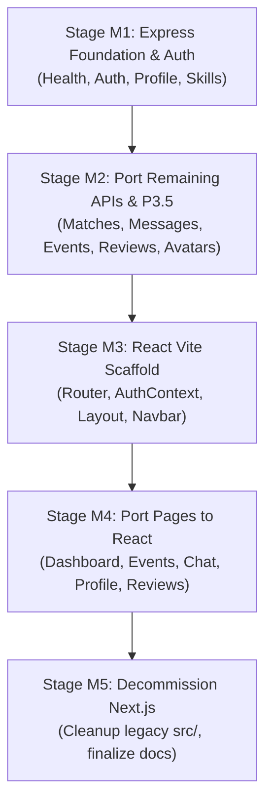

# SkillSwap Architecture Migration Plan: React (Vite) + Express

## 1. Overview & Architectural Goal

The objective is to migrate SkillSwap from a Next.js full-stack application to a decoupled architecture consisting of:
1. **Backend**: An Express.js REST API server in `server/` written in plain JavaScript (ES modules, `"type": "module"`), using Prisma 6.4 against the existing SQLite database (`prisma/dev.db`).
2. **Frontend** (in Phase M3/M4): A Single Page Application (SPA) in `client/` using React 19, Vite, Tailwind CSS v4, Lucide icons, and React Router.

### Strangler Migration Strategy
- **Zero Risk & Zero Downtime**: The existing Next.js application under `src/` remains completely **untouched** and operational on port `3001` through stages M1 to M4.
- **Shared Database**: Both the legacy Next.js app and the new Express backend point to the exact same SQLite database file (`prisma/dev.db`) using the existing `prisma/schema.prisma`. No database resets, schema deletions, or migrations will occur.
- **Rollback Guarantee**: At any point prior to M5, the entire migration can be abandoned cleanly by deleting `server/` and `client/` without affecting the working Next.js application.

---

## 2. Ports and Development Workflow

| Application Component | Development Port | Mode / Responsibilities |
|---|---|---|
| **Legacy Next.js App** | `3001` | Remains operational for baseline and parity comparisons (`PORT=3001 npm run dev`) |
| **Express Backend** | `4000` | Node.js ES modules server with `node --watch` (`PORT=4000 npm run dev` inside `server/`). Fails loudly if port 4000 is occupied. |
| **Vite Client** (M3+) | `5173` | React SPA dev server with HMR. Configured with a dev proxy: all `/api/*` requests proxy to `http://localhost:4000`. |

### Same-Origin Architecture
- **Development**: The browser interacts directly with `http://localhost:5173`. When React code calls `fetch('/api/...')`, Vite proxies the request to `http://localhost:4000`. To the browser and cookies, all requests are strictly same-origin (`localhost:5173`), eliminating CORS configuration overhead.
- **Production**: The Express server serves the compiled static production build (`client/dist`) from the same origin on port `4000` (or `PORT`).

---

## 3. Directory Structure

```
d:\project\
├── server/                           # Express backend (JavaScript ESM)
│   ├── package.json                  # "type": "module", dependencies: express, cookie-parser, etc.
│   ├── .env.example                  # Documented environment variables
│   ├── .env                          # Local server environment configuration
│   ├── eslint.config.mjs             # ESLint config for server
│   ├── vitest.config.js              # Vitest configuration for server
│   ├── src/
│   │   ├── index.js                  # Entrypoint: listens on PORT, logs readiness, handles shutdown
│   │   ├── app.js                    # Express createApp() factory
│   │   ├── config/
│   │   │   └── env.js                # Zod environment schema & validated config singleton
│   │   ├── db/
│   │   │   └── prisma.js             # PrismaClient singleton connecting to root prisma/dev.db
│   │   ├── middleware/
│   │   │   ├── auth.js               # requireSession middleware (verifies JWT cookie)
│   │   │   ├── csrf.js               # Origin header verification for state-changing methods
│   │   │   ├── error-handler.js      # Central error handler conforming to standard error format
│   │   │   ├── logger.js             # Safe request logger (never prints bodies, cookies, or secrets)
│   │   │   ├── not-found.js          # JSON 404 handler for unmatched /api/* routes
│   │   │   └── rate-limiter.js       # Rate limit middleware factory
│   │   ├── routes/
│   │   │   ├── auth.js               # /api/auth (register, login, logout, session)
│   │   │   ├── profile.js            # /api/user/profile (GET, PUT)
│   │   │   ├── users.js              # /api/users/:id (GET)
│   │   │   ├── skills.js             # /api/skills (GET, POST)
│   │   │   └── health.js             # /api/health (GET)
│   │   └── lib/                      # Ported pure domain utilities & validators
│   │       ├── api-auth.js           # Domain eligibility helpers (ported for Express)
│   │       ├── api-error.js          # Standard error response builders & validation helpers
│   │       ├── avatar-storage.js     # Storage abstraction
│   │       ├── avatar.js             # Sharp image validation & processing
│   │       ├── geo.js                # Haversine distance calculations
│   │       ├── geocode.js            # Nominatim throttle & cache
│   │       ├── matching.js           # Pure matching domain algorithms
│   │       ├── pagination.js         # Pagination utilities & header builders
│   │       ├── profile-view.js       # Safe profile mapping & viewer resolution
│   │       ├── rate-limit.js         # In-memory sliding window rate limiter
│   │       └── validators/           # Zod 4 request validation schemas
│   │           ├── auth.js
│   │           ├── events.js
│   │           ├── geocode.js
│   │           ├── index.js
│   │           ├── matches.js
│   │           ├── messages.js
│   │           ├── pagination.js
│   │           ├── profile.js
│   │           ├── reviews.js
│   │           └── skills.js
│   ├── tests/                        # Vitest test suites
│   └── scripts/
│       ├── foundation-check.mjs      # Server foundation verification script (0 data created)
│       └── parity-check.mjs          # Parity comparison script (port 3001 vs port 4000)
├── client/                           # React (Vite) frontend (To be built in M3/M4)
├── src/                              # Legacy Next.js app (UNTOUCHED during M1-M4)
├── prisma/                           # Shared Prisma schema and SQLite database
│   ├── dev.db                        # Active SQLite database (81 rows)
│   ├── schema.prisma                 # Unchanged schema
│   └── seed.js                       # Seed script
└── docs/plans/                       # Project plans
```

---

## 4. API Route Mapping Table

Every legacy Next.js API route maps 1:1 to an Express route with **identical URL paths, request shapes, and response bodies**:

| Legacy Next.js Route | Express Route | HTTP Method | Session Guard | Rate Limit Key & Limit | Stage |
|---|---|---|---|---|---|
| `/api/auth/[...nextauth]` | `/api/auth/login` | POST | None | `login:ip_email` (10/15m), `login:ip` (50/15m) | **M1** |
| `/api/auth/[...nextauth]` | `/api/auth/session` | GET | Optional | None | **M1** |
| `/api/auth/[...nextauth]` | `/api/auth/logout` | POST | None | None | **M1** |
| `/api/auth/register` | `/api/auth/register` | POST | None | `register:ip` (5/hr) | **M1** |
| `/api/user/profile` | `/api/user/profile` | GET | `requireSession` | None | **M1** |
| `/api/user/profile` | `/api/user/profile` | PUT | `requireSession` | `profile:update:<userId>` (30/hr) | **M1** |
| `/api/users/[id]` | `/api/users/:id` | GET | `requireSession` | None | **M1** |
| `/api/skills` | `/api/skills` | GET | None | None | **M1** |
| `/api/skills` | `/api/skills` | POST | `requireSession` | `skills:create:<userId>` (20/hr) | **M1** |
| `/api/matches` | `/api/matches` | GET | `requireSession` | None | M2 |
| `/api/matches` | `/api/matches` | POST | `requireSession` | `matches:create:<userId>` (20/hr) | M2 |
| `/api/matches/[id]` | `/api/matches/:id` | PATCH | `requireSession` | `matches:update:<userId>` (60/hr) | M2 |
| `/api/messages` | `/api/messages` | GET | `requireSession` | None | M2 |
| `/api/messages` | `/api/messages` | POST | `requireSession` | `messages:create:<userId>` (30/min) | M2 |
| `/api/conversations` | `/api/conversations` | GET | `requireSession` | None | M2 |
| `/api/reviews` | `/api/reviews` | GET | None | None | M2 |
| `/api/reviews` | `/api/reviews` | POST | `requireSession` | `reviews:create:<userId>` (10/hr) | M2 |
| `/api/events` | `/api/events` | GET | Optional | None | M2 |
| `/api/events` | `/api/events` | POST | `requireSession` | `events:create:<userId>` (10/hr) | M2 |
| `/api/events/[id]/rsvp` | `/api/events/:id/rsvp` | POST | `requireSession` | `events:rsvp:<userId>` (60/hr) | M2 |
| *New in M2 (P3.5)* | `/api/events/:id` | PUT / PATCH | `requireSession` | `events:update:<userId>` (30/hr) | M2 |
| *New in M2 (P3.5)* | `/api/events/:id` | DELETE | `requireSession` | `events:delete:<userId>` (30/hr) | M2 |
| `/api/geocode` | `/api/geocode` | GET | `requireSession` | `geocode:search:<userId>` (20/min) | M2 |
| `/api/user/avatar` | `/api/user/avatar` | POST | `requireSession` | `avatar:upload:<userId>` (10/hr) | M2 |
| `/api/user/avatar` | `/api/user/avatar` | DELETE | `requireSession` | `avatar:delete:<userId>` (30/hr) | M2 |
| `/api/avatars/[file]` | `/api/avatars/:file` | GET | `requireSession` | None | M2 |

---

## 5. Frontend Page & Feature Mapping Table

| Legacy Next.js Page | React Router Path | Components & Features Used | Migration Strategy | Stage |
|---|---|---|---|---|
| `/` (`page.jsx`) | `/` | Hero, value props, feature cards | Port to React functional component with standard JSX | M4 |
| `/auth` (`auth/page.jsx`) | `/auth` | Login/Signup tabs, form feedback | Connect to `AuthContext` (`login()`, `register()`) | M4 |
| `/dashboard` (`dashboard/page.jsx`) | `/dashboard` | Match cards, mutual/connected tabs, distance labels | Replace Next router/links with React Router `useNavigate` / `Link` | M4 |
| `/events` (`events/page.jsx`) | `/events` | Event cards, RSVP toggle, Leaflet MapView, CreateEventDialog | Client-side Leaflet import (no dynamic SSR workaround needed) | M4 |
| `/chat` (`chat/page.jsx`) | `/chat` | Two-panel conversation & message thread, 3s polling | Retain polling interval in `useEffect`, clean up on unmount | M4 |
| `/reviews` (`reviews/page.jsx`) | `/reviews` | Star selector, review feedback form | Port query parameters via `useSearchParams` | M4 |
| `/profile/setup` (`profile/setup/page.jsx`) | `/profile/setup` | Profile bio, skills tags, Nominatim AddressSearch, avatar upload | Native file input & FormData upload to `/api/user/avatar` | M4 |
| `/profile/[id]` (`profile/[id]/page.jsx`) | `/profile/:id` | Public profile hero, review list, connect/message CTA | Access `:id` via `useParams()` | M4 |

### Next.js Feature Replacements
- `next/link`: Replace with `Link` from `react-router`.
- `next/navigation` (`useRouter`, `useSearchParams`, `useParams`): Replace with `useNavigate`, `useSearchParams`, and `useParams` from `react-router`.
- `next-auth/react` (`useSession`, `signIn`, `signOut`): Replace with an `AuthContext` provider that exposes `user`, `status` (`loading`, `authenticated`, `unauthenticated`), `login()`, `logout()`, and `register()`.
- `next/dynamic` (used for Leaflet MapView to suppress SSR): In a Vite SPA, the entire application executes client-side; Leaflet can be imported directly (`import "leaflet"`) with no dynamic SSR wrapper required.
- `next/image`: Replace with standard HTML `` elements.

---

## 6. Authentication & Security Design

### Session Management (Replaces NextAuth)
- **Token Format**: Signed JSON Web Token (JWT) using `HS256`. The verification step strictly pins the algorithm (`algorithms: ["HS256"]`) to prevent algorithm-confusion attacks.
- **Payload**: Minimal claims only: `{ sub: user.id, iat: number, exp: number }`. User details are loaded from SQLite on each request.
- **Cookie Storage**:
  - Name: `skillswap_session`
  - `httpOnly: true` (prevents XSS access)
  - `sameSite: "lax"` (mitigates CSRF)
  - `secure: process.env.NODE_ENV === "production"`
  - `path: "/"`
  - `maxAge: 7 * 24 * 60 * 60 * 1000` (7 days)
- **Password Verification**: `bcryptjs.compare` against `user.passwordHash`. If the user is not found, `bcryptjs.compare` is run against a precomputed dummy hash to prevent timing attacks that reveal account existence.
- **Authentication Order**:
  `requireSession` (401) -> Rate limit (429) -> Zod body validation (400) -> Business logic / DB.

### CSRF Protection
For state-changing HTTP methods (`POST`, `PUT`, `PATCH`, `DELETE`):
- If the request includes an `Origin` header, the value must match an entry in `ALLOWED_ORIGINS` (defaults to `http://localhost:5173` and `http://localhost:4000`). If mismatched, the server returns `403 Forbidden` (`{ "error": "Invalid origin" }`).
- Requests without an `Origin` header (e.g. mobile apps, curl, or standard same-origin navigation) are permitted, supported by `SameSite=Lax` cookies.

### Security Headers
`helmet` is configured for a JSON API backend:
- `contentSecurityPolicy: false` (not serving HTML)
- `crossOriginResourcePolicy: { policy: "same-site" }`
- Standard headers enabled: `X-Content-Type-Options: nosniff`, `X-Frame-Options: SAMEORIGIN`, `Strict-Transport-Security`, `X-XSS-Protection`.

---

## 7. Migration Stages & Exit Criteria



### Stage M1: Express Server Foundation & Initial APIs (Current Task)
- **Scope**: Express scaffold in `server/`, env validation, Prisma singleton, JWT auth system, `api-auth`/`api-error` porting, `/api/health`, `/api/auth/*`, `/api/user/profile`, `/api/users/:id`, `/api/skills`.
- **Exit Criteria**:
  - `server/` passes `npm run lint` (0 errors, 0 warnings) and `npm test`.
  - `server/scripts/foundation-check.mjs` passes 100% (creates 0 records).
  - `server/scripts/parity-check.mjs` confirms 100% payload equality between Next.js (port 3001) and Express (port 4000).
  - Legacy Next.js app on port 3001 passes all 8 check scripts (161 assertions).
  - Database row counts remain exactly 81.

### Stage M2: Port Remaining APIs & Native Feature P3.5
- **Scope**: Matches, messages, conversations, reviews, events + RSVP, geocoding, avatar upload.
- **Native Feature P3.5**:
  - Event host edit and cancel (`PUT /api/events/:id`, `DELETE /api/events/:id`).
  - Optional attendee limit (`maxAttendees`) with capacity enforcement (returns `409 Conflict` when full).
  - RSVP rules for cancelled events.
- **Exit Criteria**: All 15 existing endpoints plus P3.5 pass full integration check scripts against port 4000.

### Stage M3: React (Vite) Frontend Scaffold
- **Scope**: Create `client/` using Vite + React 19, Tailwind CSS v4, React Router, Vite dev proxy (`/api` -> 4000), `AuthContext`, root layout, and `Navbar`.
- **Exit Criteria**: Client renders navbar, routes change cleanly, auth status reflects session cookie.

### Stage M4: Port Pages One by One
- **Scope**: Port `/`, `/auth`, `/dashboard`, `/events` (Leaflet map), `/chat`, `/profile/setup`, `/profile/:id`, `/reviews`.
- **Exit Criteria**: All features functional in browser via `http://localhost:5173`. Parity checks with Next.js UI verified.

### Stage M5: Decommission Next.js & Final Clean-Up
- **Scope**: Remove legacy `src/`, root Next.js dependencies, update CI workflows and documentation.
- **Exit Criteria**: Clean single-repository layout (`server/` + `client/`), 100% tests passing, production build verification.

---

## 8. Post-Migration Roadmap Continuation

Following completion of M5, development resumes along the existing project roadmap:
- **Phase 4 (Chat & Notifications)**: P4.1 Unread message counts; P4.2 Server-Sent Events (SSE) or WebSocket integration; P4.3 In-app notifications.
- **Phase 5 (Database Migration)**: P5.1 PostgreSQL migration via Prisma; P5.2 Production vs. dev seed separation.
- **Phase 6 (Security & Testing)**: P6.1 Security audit & CSRF hardening; P6.2 Playwright E2E suite; P6.3 GitHub Actions CI; P6.4 Google OAuth rebuild for Express.
- **Phase 7 (Deployment & Operations)**: P7.1 Deployment (e.g. Railway/Render), production envs; P7.2 Resend email integration; P7.3 Monitoring.

---

## 9. Rollback Plan

If any critical issue arises during stages M1 through M4:
1. Stop the Express dev process on port `4000`.
2. Delete `server/` (and `client/` if created).
3. The legacy Next.js application in `src/` remains completely unmodified, functional, and verified on port `3001` with zero data loss or schema alterations.

